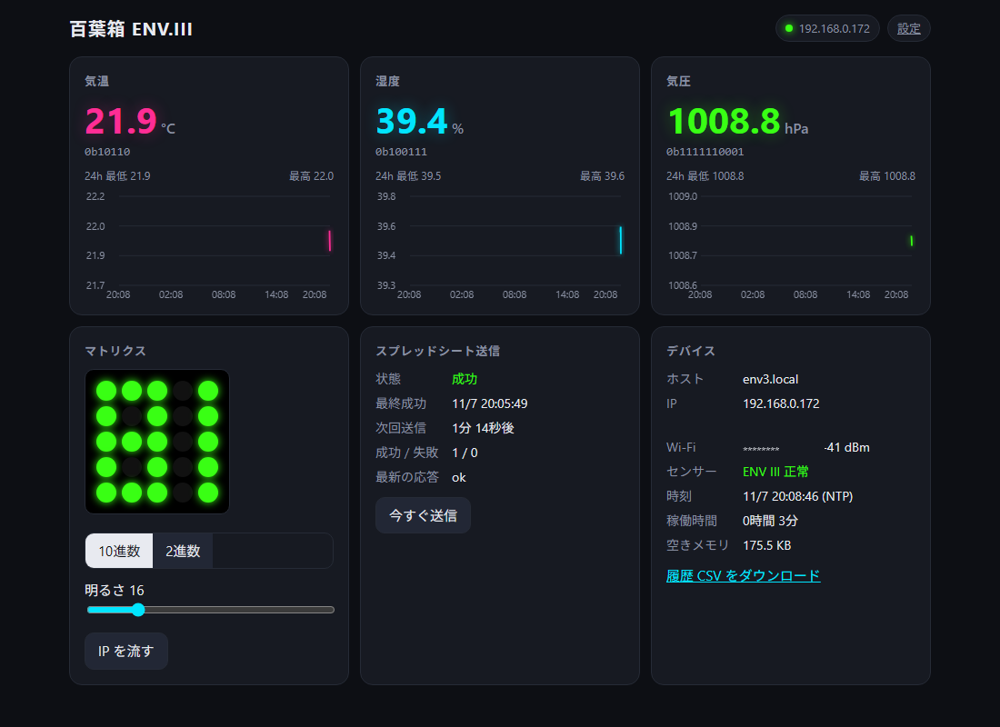
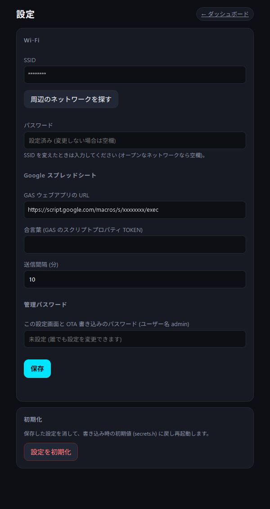
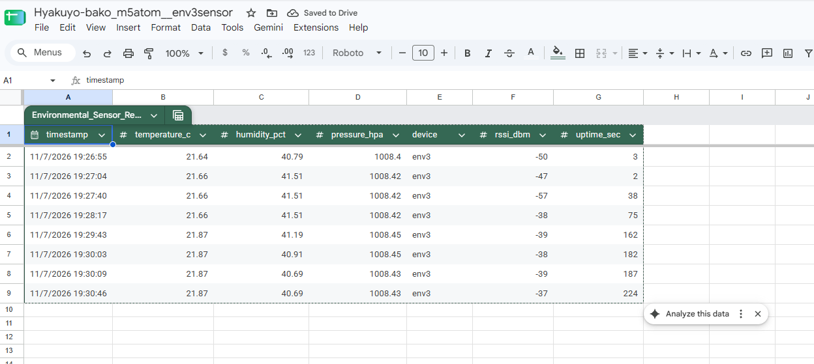

# 百葉箱 M5Atom Matrix + ENV III

M5Atom Matrix に Unit ENV III (SHT30 + QMP6988) をつなぎ、

- 5x5 マトリクスに 気温 / 湿度 / 気圧 をスクロール表示
- 10 分ごとに Google Apps Script 経由でスプレッドシートへ記録 (送信先は最大 10 件)
- GAS を読み出し API としても使い、最新値や任意の時刻の値を取得
- 同じ LAN のブラウザから現在値・24 時間グラフ・送信状況を確認
- センサーを追加しやすい構成 (値を登録するだけで表示・記録・送信に載る)

するファームウェアです。PlatformIO でビルドします。

## スクリーンショット

| ダッシュボード | 設定画面 |
| --- | --- |
|  |  |

スプレッドシートへの記録



## 配線

ENV III を Atom Matrix の Grove ポートに挿すだけです (SDA=G26, SCL=G32)。

## マトリクス表示

| 項目 | 色 | 例 (10進数) | 例 (2進数) |
| --- | --- | --- | --- |
| 気温 | 蛍光ピンク | `23.4°C` | `10111°C` |
| 湿度 | 蛍光シアン | `45.6%` | `101110%` |
| 気圧 | 蛍光グリーン | `1013.2hPa` | `1111110101hPa` |

- **ボタンをクリック**: 10進数 / 2進数 を切り替え (2進数は整数に四捨五入した値)。設定は再起動後も保持されます。
- **ボタンを長押し (1秒)**: IP アドレスを白で流します。起動して Wi-Fi につながったときにも 1 回流れます。
- **ボタンを押しながら起動**: セットアップモード (下記) で起動します。
- セットアップモード中は各周回の頭に白で `AP` が流れます。
- センサーが見つからないときは赤で `ERR` を流します。

## セットアップ

### 1. Google スプレッドシートと GAS

1. 新しいスプレッドシートを作り、「拡張機能 > Apps Script」を開く。
2. [gas/Code.gs](gas/Code.gs) の内容を貼り付けて保存。
3. (任意) 「プロジェクトの設定 > スクリプト プロパティ」で合言葉を設定。
   - `TOKEN`: デバイスからの書き込みに必要な合言葉 (デバイスの設定画面の「合言葉」と同じ値)
   - `READ_TOKEN`: [読み出し API](#スプレッドシートの読み出し-api-gas) に必要な合言葉。未設定なら URL を知っていれば誰でも読めます
4. 「デプロイ > 新しいデプロイ > 種類: ウェブアプリ」
   - 次のユーザーとして実行: **自分**
   - アクセスできるユーザー: **全員**
5. 表示されたウェブアプリの URL (`https://script.google.com/macros/s/.../exec`) を控える。

`data` シートが自動で作られ、1 行目が列名になります。`timestamp` (GAS 側の受信時刻) と `device` のほか、
デバイスが送ってきた値のキー (`temperature_c`, `humidity_pct`, `pressure_hpa`, `rssi_dbm`, `uptime_sec` …) がそのまま列名になります。
知らないキーが来たら右端に列を足すので、センサーを追加しても Code.gs を変える必要はありません。既存の列の並びはそのまま使います。

> Code.gs を書き換えたときは「デプロイを管理 > 編集 > バージョン: 新バージョン」で更新すると URL が変わりません。

複数のスプレッドシートに送りたい場合は、それぞれに Code.gs をデプロイして、デバイスの設定画面で送信先を追加します (最大 10 件)。

### 2. ビルドと書き込み

```sh
pio run -e m5atom-matrix -t upload
pio device monitor
```

### 3. ブラウザから設定 (セットアップモード)

Wi-Fi が未設定、または 15 秒以内につながらないときは、本体がアクセスポイントになります。

1. PC / スマホで Wi-Fi `env3-setup-XXXX` (パスワード `env3setup`) に接続する。
2. 設定画面が自動で開かなければ `http://192.168.4.1/settings` を開く。
3. Wi-Fi (「周辺のネットワークを探す」で選べます)、GAS の送信先 (URL・合言葉。「送信先を追加」で最大 10 件)、送信間隔を入力して保存。
4. 本体が再起動して家の Wi-Fi につながります。PC / スマホを元の Wi-Fi に戻して `http://env3.local/` を開く。

設定は本体のフラッシュ (NVS) に保存され、書き込み直しても消えません。
つながっている状態でも、ダッシュボード右上の「設定」からいつでも変更できます (Wi-Fi を変えたときだけ再起動します)。
保存済みの Wi-Fi につながらないときもセットアップモードになり、AP に誰もつないでいない間は 30 秒おきに再接続を試します。

ESP32 は 2.4GHz の Wi-Fi にしかつながりません。

#### 管理パスワード

設定画面で管理パスワードを決めると、設定画面にユーザー名 `admin` で Basic 認証がかかり、OTA 書き込みのパスワードにもなります。
未設定だと同じ LAN の誰でも設定を変えられるので、設定しておくのがおすすめです。

#### secrets.h (任意)

`include/secrets.example.h` を `include/secrets.h` にコピーして値を書くと、それが「まだ何も保存されていないとき」の初期値になります。
複数台に同じ設定を入れたいとき向けです。設定画面の「設定を初期化」でもこの値に戻ります。

Wi-Fi につながった後は Wi-Fi 経由でも書き込めます (管理パスワードを設定したら [platformio.ini](platformio.ini) の `--auth` も合わせる)。

```sh
pio run -e m5atom-matrix-ota -t upload
```

## ブラウザ

マトリクスに流れる IP、または `http://env3.local/` を開きます (mDNS 非対応の Android などは IP で)。

- 登録された全ての値 (現在は気温・湿度・気圧) と 2 進数表記
- 24 時間のグラフと最低 / 最高 (1 分ごとに記録。デバイス内 RAM に保持するので再起動で消えます)
- マトリクスのミラー表示、10進 / 2進 切り替え、明るさ調整、IP 表示
- スプレッドシート送信の状態 (送信先ごと)、次回送信までの時間、「今すぐ送信」
- センサーの状態、Wi-Fi 強度、稼働時間、空きメモリ
- 履歴 CSV のダウンロード
- 設定 (`/settings`): Wi-Fi、GAS の送信先 (最大 10 件)、送信間隔、管理パスワード

### API

| メソッド | パス | 内容 |
| --- | --- | --- |
| GET | `/api/status` | 現在値 (`metrics`)・センサー状態・送信先ごとの状況・デバイス情報 (JSON) |
| GET | `/api/history` | 直近 24 時間の履歴 (JSON。`keys` の順に `[uptime秒, 値1, 値2, …]` の配列) |
| GET | `/history.csv` | 履歴 CSV |
| GET | `/api/matrix` | マトリクス 25 ピクセルの色 (`rrggbb` x 25) |
| POST | `/api/mode?value=decimal\|binary` | 表示モード切り替え (`value` なしでトグル) |
| POST | `/api/brightness?value=1..80` | 明るさ |
| POST | `/api/upload` | 今すぐスプレッドシートへ送信 |
| POST | `/api/showip` | マトリクスに IP を流す |
| GET | `/api/settings` | 現在の設定 (パスワードは返さない) ※ |
| POST | `/api/settings` | 設定を保存 (フォーム形式) ※ |
| GET | `/api/scan` | 周辺の Wi-Fi 一覧 ※ |
| POST | `/api/reset` | 保存した設定を消して再起動 ※ |

※ 管理パスワードを設定している場合は Basic 認証 (ユーザー名 `admin`) が必要です。

## 送信タイミング

送信間隔は設定画面で 1〜60 分に変えられます (初期値 10 分)。
NTP で時刻が合っていれば間隔ちょうど (10 分なら毎時 00, 10, 20 … 分) に送ります。時刻が合う前は起動直後に 1 回送り、以降は間隔おき。
登録した全ての送信先に同じ値を送り、通信エラーになった送信先だけ 30 秒おきに 2 回まで再送します
(GAS に届いて拒否された場合や、書き込みが済んだ場合は再送しません)。

### 送信データの形式

```json
{
  "token": "合言葉",
  "device": "env3",
  "values": {"temperature_c": 21.64, "humidity_pct": 40.79, "pressure_hpa": 1008.40, "rssi_dbm": -50, "uptime_sec": 3}
}
```

v1.1 以前の Code.gs でも記録できるよう、`temperature` などトップレベルの値も一緒に送っています。

## スプレッドシートの読み出し API (GAS)

デプロイした GAS の URL に GET でアクセスすると、記録した値を JSON で返します。

| パラメータ | 内容 |
| --- | --- |
| (なし) / `action=latest` | 最新の 1 行 |
| `action=at&time=…` | 指定時刻にいちばん近い 1 行 (`diffSec` に指定時刻との差) |
| `action=range&from=…&to=…&limit=…` | 期間内の行 (古い順。`limit` は既定 500 / 最大 5000) |
| `action=info` | 列名・行数・最初と最後の時刻 |
| `device=env3` | デバイスで絞り込み (複数台で 1 つのシートを使うとき) |
| `keys=temperature_c,humidity_pct` | 返す列を絞り込み |
| `token=…` | スクリプトプロパティ `READ_TOKEN` を設定したときに必要 |

時刻は `2026-11-07T19:30:00+09:00` (ISO 8601)、`2026-11-07 19:30` (スクリプトのタイムゾーン)、UNIX 秒 / ミリ秒のどれでも指定できます。

```sh
curl -L "https://script.google.com/macros/s/.../exec"
# {"ok":true,"data":{"timestamp":"2026-11-07T20:20:06+09:00","temperature_c":21.81,"humidity_pct":40.2,"pressure_hpa":1008.86,"device":"env3","rssi_dbm":-41,"uptime_sec":8}}

curl -L "https://script.google.com/macros/s/.../exec?action=at&time=2026-11-07%2019:30&keys=temperature_c"
# {"ok":true,"data":{"timestamp":"2026-11-07T19:30:03+09:00","temperature_c":21.87,"device":"env3"},"diffSec":3}
```

GAS はリダイレクトしてから結果を返すので、`curl` では `-L` が必要です。ブラウザの `fetch()` はそのまま使えます。

## センサーの追加

センサーは [src/sensors/sensor.h](src/sensors/sensor.h) の `Sensor` を継承して作ります。
値 (`Metric`) を登録すると、マトリクス・ダッシュボード・グラフ・CSV・GAS 送信 (列の追加) に自動で載ります。

1. `src/sensors/` にクラスを作る ([env3_sensor.cpp](src/sensors/env3_sensor.cpp) が例です)。

   ```cpp
   class Co2Sensor : public Sensor {
    public:
     Co2Sensor() : Sensor("SCD40") {
       // key, 表示名, 単位, マトリクス用の単位, 小数点以下の桁数, 色
       addMetric({"co2_ppm", "CO2", "ppm", "ppm", 0, 0xFFA500});
     }

    protected:
     bool begin() override {  // 見つかったら true
       return scd4x_.begin(&Wire, SCD4X_I2C_ADDR, PIN_SDA, PIN_SCL, 400000U) && scd4x_.startPeriodicMeasurement();
     }
     bool read() override {                                   // 読めたら値を入れて true
       if (!scd4x_.update()) return false;
       metrics()[0].value = scd4x_.getCO2();
       return true;
     }

    private:
     SCD4X scd4x_;
   };
   ```

2. [src/main.cpp](src/main.cpp) でインスタンスを作り、`setup()` で `sensors.add()` する。

   ```cpp
   Co2Sensor co2;
   // setup() の中
   sensors.add(&env3);
   sensors.add(&co2);
   ```

- `key` はスプレッドシートの列名と API のキーになります。単位まで含めた英小文字 (例: `co2_ppm`) がおすすめです。
- マトリクス用の単位は 3x5 フォントにある文字 (数字、`A`〜`Z`、`a g h k l m p u x`、`% * . - + / :`、`*` は °) で書きます。
- マトリクスに出したくない値は `onMatrix` を `false` にします。
- 見つからないセンサーは 5 秒おきに `begin()` をやり直し、3 回続けて読めないと値を空 (`null`) にします。
- 値は全部で 24 個まで登録できます (`SensorHub::kMaxMetrics`)。

## 設定の変更

色・ピン・明るさの上限・セットアップ用 AP のパスワードなどは [include/config.h](include/config.h) にまとめています。

## 補足

- SHT30 は Atom 本体の熱を拾いやすいので、ケーブルで少し離して設置すると気温が正確になります。
- マトリクスは明るくすると発熱するため、明るさの上限を 80/255 にしています。
- GAS への HTTPS は証明書検証を省略しています (`setInsecure`)。送っているのは測定値と合言葉だけです。
- GAS の URL を知っていれば誰でも書き込み・読み出しができるので、公開する場所に URL を載せる場合は `TOKEN` / `READ_TOKEN` を設定してください。
- セットアップ用 AP のパスワード `env3setup` は公開リポジトリに載っている値です。気になる場合は [include/config.h](include/config.h) の `SETUP_AP_PASSWORD` を変えてください。
